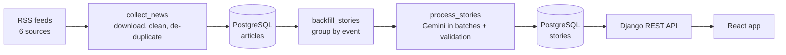

<div align="center">

# 📡 Clarion AI

### Stay ahead in the rapidly changing world of AI.

**Clarion doesn't give you more AI news. It gives you less noise.**

It reads AI news from labs and tech publications, merges articles about the *same*
development into one story, explains why it matters, and ranks everything in a clean feed.

[](https://github.com/<username>/clarion-ai/actions/workflows/ci.yml)


<!-- Add after you deploy:
**[🌐 Live demo](https://your-site.pages.dev)**
-->

</div>

<!-- Add screenshots (take them from the running app), then uncomment:

<p align="center">
  
  
</p>
-->

---

## Contents

- [Why Clarion?](#why-clarion)
- [Features](#features)
- [How it works](#how-it-works)
- [Quick start](#quick-start)
- [Configuration](#configuration)
- [Commands](#commands)
- [API](#api)
- [Design decisions](#design-decisions)
- [Testing](#testing)
- [Deployment](#deployment)
- [Project structure](#project-structure)
- [Known limitations](#known-limitations)
- [Roadmap](#roadmap)
- [License](#license)

---

## Why Clarion?

AI news is scattered across lab blogs, research sites and tech press. One announcement
is covered by many outlets, while unrelated articles often have near-identical
headlines. Reading it all is slow and repetitive.

Clarion turns that noise into signal:

| Instead of... | Clarion gives you... |
|---|---|
| 10 articles about the same launch | **One story** with all sources linked |
| Ads, event promos, off-topic items | **Filtered out** before they reach the feed |
| Guessing what matters | A **"why it matters"** line and an **importance score** |
| Yesterday's news on top | **Freshness-aware ranking** ("Today in AI") |

> Correctness and trust matter more than volume. A smaller feed of accurate,
> well-grouped stories beats a big feed of wrongly merged ones.

---

## Features

- **Smart grouping** – articles about the same event are merged using explicit, tested
  rules, not a single fuzzy similarity score.
- **AI summaries you can trust more** – Gemini writes a headline, summary, "why it
  matters", category and importance score, and **every field is validated** before it
  is saved.
- **Coherence check** – for multi-article stories Gemini must confirm they describe
  *one* event; otherwise the story is parked for review instead of getting a mixed summary.
- **Noise filtering** – an `ai_related` flag and an importance rubric push ads,
  promotions and off-topic items out of the feed.
- **Three ways to read** – *Top stories*, *Latest* and *Most important*, plus a
  **Trending** page (last 48 hours) and full-text **search**.
- **Filters** – category, source, minimum importance and date range.
- **Built for free-tier AI** – per-model daily request budgets, per-minute pacing,
  batching (5 stories per request) and automatic fallback to another Gemini model.
- **Resilient updates** – one broken feed or a temporary Gemini outage never
  stops the rest of the pipeline, and outages are never counted as story failures.
- **Honest data handling** – undated articles are kept but **never given an invented
  date** and never grouped with dated ones.
- **Safe maintenance** – `regroup_stories` is a dry run by default, atomic, and
  checks that every single article is accounted for.
- **Production-ready** – environment-based config, health check, rate limiting,
  hidden admin URL, CI, and a scheduled GitHub Actions updater.

---

## How it works



`python manage.py update_news` runs the three pipeline steps in order and keeps going
if one of them fails.

| Step | Command | What happens |
|---|---|---|
| **1. Collect** | `collect_news` | Downloads feeds (with timeout + one retry), decodes HTML entities, removes invisible characters, drops duplicates by URL and by title hash. |
| **2. Group** | `backfill_stories` | Decides whether each new article joins an existing story or starts a new one. |
| **3. Summarise** | `process_stories` | Sends stories to Gemini in batches, validates the answer, and saves headline, summary, why-it-matters, category and score. |
| **4. Rank** | API | *Top stories* = 45% importance + 40% freshness + 15% corroboration. *Trending* = the last 48 hours, top 20 (widens to 5 days on a quiet news day). |

**Sources:** OpenAI · Google DeepMind · Hugging Face · MIT Technology Review ·
The Verge · TechCrunch

<details>
<summary><b>🧩 How article grouping works (click to expand)</b></summary>

<br>

Two articles are merged only if they are **close in time** (4 days at most) **and**
one of these rules fires. There is no weighted score where several weak signals can
add up to a false match.

| Rule | When it merges | Example |
|---|---|---|
| **Identical** | Same distinctive words | A re-posted headline |
| **A – wording** | Near-identical wording (stricter for the same publisher) | Two outlets, one headline |
| **B – entity** | Different publishers share a *specific* entity (e.g. `gpt-5.1`) | A launch covered by two sites |
| **C – same publisher** | Same publisher, shared entity, same day | "Introducing GPT-5" + "GPT-5 for developers" |
| **C2 – model version** | Same publisher, **same model version**, same day | Three Gemini 4 Argon posts |
| **D – overlap** | Different publishers share 3+ meaningful words | Same story, different words |
| **E – rare words** | Different publishers, same day, a shared word that is **rare** in recent titles | "Bluesky" + "Attie" |

Safeguards:

- 🏷️ **Generic organisations are ignored** – sharing "OpenAI" or "Google" proves nothing.
- 🧑‍💼 **Customer case studies never merge** with each other or with launches
  ("How Amgen uses GPT-5" ≠ "How AstraZeneca uses GPT-5").
- 🔗 **No chains** – a new article must match the *majority* of a group, so
  A≈B and B≈C cannot pull an unrelated A and C together.
- 📅 **No date, no merge** – undated articles are never grouped.
- 🔤 **Everyday words don't count** – "says", "time", "like"… are ignored.

When in doubt, Clarion keeps two cards rather than merging two different events.

</details>

<details>
<summary><b>🤖 How the AI step stays reliable (click to expand)</b></summary>

<br>

- Stories are sent in **batches of 5** to save requests on free tiers.
- The reply must be valid JSON, mapped back to the **right story**, with a valid
  category, a numeric score between 0 and 100, and non-empty, length-limited text.
- For multi-article stories `same_event` must be an explicit `true`/`false`.
  *Missing or malformed counts as a failure, never as approval.*
- **A bad answer never overwrites a good summary.**
- **Quota errors (429) and outages (503)** make Clarion skip that model for a while
  and try the next one. Stories stay queued and are **not** counted as failures.
- Stories that genuinely fail 3 times are **parked**, and `requeue_failed` helps
  you review them.
- A scoring rubric anchors the importance score (for example: flagship model launch ≈ 80,
  customer case study ≈ 20, ad or promotion ≈ 5).

</details>

---

## Quick start

### Requirements

- **Python 3.11**
- **Node.js 22** and npm
- **PostgreSQL** (a local database)
- A **Gemini API key** from [Google AI Studio](https://aistudio.google.com/)

### 1. Get the code and install the backend

```powershell
git clone https://github.com/<username>/clarion-ai.git
cd clarion-ai

python -m venv venv
venv\Scripts\activate            # macOS/Linux: source venv/bin/activate
pip install -r requirements.txt
```

### 2. Create the database

```powershell
createdb -U postgres clarion_db   # or create "clarion_db" in pgAdmin
```

### 3. Configure

```powershell
copy .env.example .env            # macOS/Linux: cp .env.example .env
```

Open `.env` and fill in your secret key, database password and Gemini key.
See [Configuration](#configuration). **Never commit `.env`.**

### 4. Set up and run the backend

```powershell
python manage.py migrate
python manage.py createsuperuser   # optional, for the admin
python manage.py update_news       # collect -> group -> summarise
python manage.py runserver         # http://127.0.0.1:8000
```

### 5. Run the frontend (second terminal)

```powershell
cd frontend
npm install
npm run dev                        # http://localhost:5173
```

Open **http://localhost:5173** 🎉

> **First run tip:** the first `update_news` collects the last 7 days of articles.
> Summaries are generated 20 stories at a time to respect Gemini's free-tier limits,
> so run `python manage.py process_stories` a few more times to fill the feed.

---

## Configuration

Everything comes from environment variables. For local work, put them in `.env`
(see [`.env.example`](.env.example)). In production, set them in your hosting
dashboards (see [DEPLOY.md](DEPLOY.md)).

### Core

| Variable | Required | Description |
|---|:---:|---|
| `DJANGO_SECRET_KEY` | ✅ | Long random string. A dev fallback exists only when `DEBUG=True`. |
| `DEBUG` | | `True` for local development. **Defaults to `False`.** |
| `GEMINI_API_KEY` | ✅ | Your Google AI Studio key. |
| `DATABASE_URL` | prod | Full Postgres URL (used when set, e.g. Neon). |
| `DB_NAME` `DB_USER` `DB_PASSWORD` `DB_HOST` `DB_PORT` | local | Local Postgres settings (used when `DATABASE_URL` is not set). |
| `ALLOWED_HOSTS` | prod | Comma-separated hostnames. |
| `CORS_ALLOWED_ORIGINS` | prod | Your website URL(s). |

### Gemini free-tier controls

| Variable | Example | Description |
|---|---|---|
| `GEMINI_MODELS` | `gemini-3.5-flash:18:5,gemini-3.1-flash-lite:480:15` | Models tried **in order**. Format: `model:requests_per_day:requests_per_minute`. |
| `GEMINI_TIMEOUT_MS` | `60000` | Give up on a request after this long. |
| `GEMINI_DAILY_REQUEST_LIMIT` / `GEMINI_RPM_LIMIT` | `18` / `5` | Defaults for models without explicit numbers. |

> Check **Google AI Studio → Rate Limit** for the real limits on *your* account. They
> differ by model and change over time. Clarion keeps its own daily counter in the
> database, so the guard works on hosts that wipe their disk between runs.

### Production hardening

| Variable | Description |
|---|---|
| `BEHIND_PROXY=True` | Trust the host's `X-Forwarded-Proto` header (Render, Fly…). |
| `SECURE_SSL_REDIRECT=True` | Redirect http → https (`/api/health/` is exempt). |
| `SESSION_COOKIE_SECURE` `CSRF_COOKIE_SECURE` | Use `True` over https. |
| `SECURE_HSTS_SECONDS` | e.g. `31536000` once https works. |
| `CSRF_TRUSTED_ORIGINS` | Your API's https origin (for the admin login). |
| `ADMIN_URL` | A hard-to-guess admin path, e.g. `manage-k3x9q/`. |
| `API_THROTTLE_ANON` | Rate limit per client (default `120/min`). |
| `LOG_LEVEL` | Default `INFO`. |

### Frontend

| Variable | Description |
|---|---|
| `VITE_API_URL` | Backend URL. **Not needed locally** (defaults to `http://127.0.0.1:8000`). **Required for production builds**, which fail on purpose without it. Set it in your hosting dashboard, not in a committed file. |

---

## Commands

| Command | What it does |
|---|---|
| `python manage.py update_news` | The full pipeline. This is what the scheduler runs. |
| `python manage.py collect_news` | Step 1 only: download and save new articles. |
| `python manage.py process_stories` | Step 3 only. Options: `--limit`, `--batch-size`, `--retry-failed`. |
| `python manage.py process_stories --limit 0` | Summarise **every** pending story. |
| `python manage.py regroup_stories` | **Dry run:** report how articles *would* be regrouped. |
| `python manage.py regroup_stories --apply` | Apply it (one transaction; all articles accounted for). |
| `python manage.py find_near_duplicates` | Read-only: list possible missed merges for review. |
| `python manage.py requeue_failed` | List parked stories (`--apply` re-queues the safe ones). |
| `python manage.py fix_titles` | Clean HTML entities and invisible characters in stored titles. |
| `python manage.py test news` | Run the test suite. |

### Running it automatically

- **GitHub Actions (recommended):** `.github/workflows/update.yml` runs the pipeline
  every 4 hours, even when your PC is off. See [DEPLOY.md](DEPLOY.md).
- **Windows Task Scheduler (local):** run `update_clarion.bat` every few hours. The
  PC must be on and you must be signed in.

---

## API

A read-only JSON API. Responses are paginated (10 per page) and cacheable for a minute.

| Endpoint | Description |
|---|---|
| `GET /api/feed/` | Ranked feed. `?sort=top` (default) · `latest` · `important` |
| `GET /api/trending/` | The most active stories of the last 48 hours (max 20). |
| `GET /api/stories/` | Browse and search all stories. |
| `GET /api/stories/<id>/` | One story with all its source articles. |
| `GET /api/health/` | `{"status": "ok"}` when the app and database are up. |

<details>
<summary><b>Query parameters</b></summary>

<br>

| Parameter | Applies to | Example |
|---|---|---|
| `page` | all lists | `?page=2` |
| `category` | feed, stories | `?category=Models` |
| `source` | feed, stories | `?source=TechCrunch` |
| `min_importance` | feed, stories | `?min_importance=50` |
| `from` / `to` | feed, stories | `?from=2026-10-01&to=2026-10-20` |
| `search` | feed, stories | `?search=gemini` |
| `sort` | feed | `top` (default) · `latest` · `important` |
| `sort` | stories | `latest` · `oldest` · `important` |

Categories: `Models` · `Agents` · `Research` · `Products` · `Business` ·
`Developer Tools` · `Safety` · `Other`.

Invalid parameters return `400` with a clear message; unknown stories return `404`.

</details>

---

## Design decisions

**Rules before ML.** Grouping uses deterministic, explainable rules with regression
tests built from real headlines. When a mistake happens, you can see *which rule*
fired and fix it, which is harder with an opaque model.

**Precision over recall.** Wrongly merging two events poisons the summary, the
category and the score. Showing two cards is a smaller mistake than showing one
wrong card.

**Never invent data.** No publication date means no date: those articles are kept but
stay ungrouped, hidden from the feed, and don't use any AI quota.

**Validate every AI answer.** The model is treated as an untrusted component. Output
is checked field by field, and a failed check leaves existing data untouched.

**Fail soft.** Timeouts, quota limits and outages stop *that step*, never the whole
pipeline, and never mark healthy stories as failed.

**Free-tier friendly.** Batching, pacing, budgets and model fallback keep the project
running at no cost.

---

## Testing

```powershell
python manage.py test news          # 86 backend tests
cd frontend
npm run lint
npm run build
```

The backend suite covers:

- story matching, using **real headlines** that caused mistakes in the past
- AI-output validation and batch-to-story mapping
- undated articles and safe regrouping (dry run, atomic, nothing lost)
- quota, outage and fallback-model handling (Gemini is mocked, so no network or cost)
- feed and trending ranking, the API, caching and the health check

GitHub Actions runs the same checks on every push and pull request.

---

## Deployment

A step-by-step guide using free tiers is in **[DEPLOY.md](DEPLOY.md)**:

| Piece | Service |
|---|---|
| Database | Neon (PostgreSQL) |
| API | Render (Web Service, gunicorn) |
| Website | Cloudflare Pages |
| Scheduler | GitHub Actions |

Free tiers change, so verify each provider's current limits before you start. Free
web services typically sleep after a period of inactivity, so the first visit after a
quiet period can be slow.

---

## Project structure

```
clarion-ai/
├── backend/                 # Django project: settings, urls, wsgi
├── news/
│   ├── management/commands/ # pipeline + maintenance commands
│   ├── migrations/
│   ├── services/
│   │   ├── rss_collector.py       # feed download and parsing
│   │   ├── story_matcher.py       # the grouping rules
│   │   ├── story_ai_processor.py  # Gemini prompt + validation
│   │   ├── gemini_client.py       # quotas, pacing, model fallback
│   │   ├── feed_scoring.py        # Top stories ranking
│   │   └── trending.py            # Trending ranking
│   ├── models.py            # Article, Story, GeminiUsage
│   ├── views.py             # API views
│   └── tests.py
├── frontend/                # React + Vite app
│   └── src/ {api, components, hooks, pages, utils}
├── .github/workflows/       # CI + scheduled updater
├── DEPLOY.md
├── requirements.txt
└── update_clarion.bat       # optional local scheduler launcher
```

---

## Known limitations

- **AI can be wrong.** Headlines, summaries and scores are generated from article titles
  and short feed descriptions. Always use the **Read original** links for details.
- **Some duplicates remain.** When two publishers cover one event with very different
  wording, the stories may stay separate. This is deliberate (see *Design decisions*),
  and `find_near_duplicates` helps you review them.
- **Limited sources.** Six feeds means "covered by several sources" is uncommon.
- **Free-tier constraints.** Gemini limits differ by model and account, and free hosting
  may sleep when idle.
- **No accounts.** Clarion is a public read-only reader by design.

---

## Roadmap

Ideas, in rough priority order:

- [ ] Deploy publicly and add screenshots / a live demo link
- [ ] More sources (more labs and independent outlets)
- [ ] Better cross-source matching with text embeddings
- [ ] Simple pipeline dashboard (last run, failures, quota use)
- [ ] Weekly review report of near-duplicates and parked stories

---

## License

Released under the **MIT License**, see [LICENSE](LICENSE).

---

<div align="center">

Built to make AI news **clearer, not louder.** 📡

</div>
